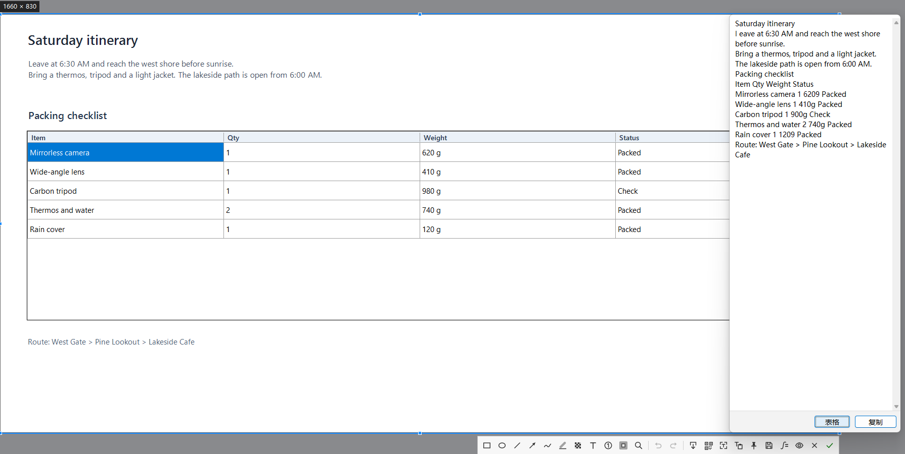

# sniplite

**轻量、快速的 Windows 截图与贴图工具**

        · [下载 Releases](https://github.com/jinmeng3/sniplite/releases)

  

 
 
 

 

## 功能

- **截图**：识别窗口和控件，提供放大镜及像素级选区调整。
- **标注和贴图**：绘制箭头、文字、序号和马赛克，也可将截图置顶显示。
- **二维码识别**：在截图选区按 `Ctrl+Q` 识别二维码，结果留在本机并可复制。
- **公式识别**：可选 FormulaNet 模块，在本机将截图选区转换为 LaTeX 并复制。
- **文字识别**：可选 OCR 模块，支持普通文字和表格识别，在本机运行。
- **长截图**：滚动页面时自动拼接内容。
- **轻量运行**：截图、画面合成和绘制等性能敏感部分使用 x86-64 汇编；主程序不链接 C 运行库。
- **隐私**：截图和识别内容在本机处理；软件不含广告。

## 下载

前往 [GitHub Releases](https://github.com/jinmeng3/sniplite/releases) 下载当前版本。v1.5.1.3 提供以下版本：

- [Windows 安装程序](https://github.com/jinmeng3/sniplite/releases/download/v1.5.1.3/sniplite_win_setup_amd64.exe)
- [二维码便携版](https://github.com/jinmeng3/sniplite/releases/download/v1.5.1.3/sniplite_1.5.1.3_portable_QR_x64.zip)：主程序、二维码识别程序及其许可证。
- [二维码 + OCR 便携版](https://github.com/jinmeng3/sniplite/releases/download/v1.5.1.3/sniplite_1.5.1.3_portable_QR_OCR_x64.zip)
- [二维码 + OCR + FormulaNet 便携版](https://github.com/jinmeng3/sniplite/releases/download/v1.5.1.3/sniplite_1.5.1.3_portable_QR_OCR_FormulaNet_x64.zip)
- [无需预装 WebView2 的便携版](https://github.com/jinmeng3/sniplite/releases/download/v1.5.1.3/sniplite_1.5.1.3_portable_QR_OCR_FormulaNet_WebView2_x64.zip)：附带 Fixed Version Runtime 158.0.4370.33。

解压后运行 `sniplite.exe`。命令行功能由 `sniplite-cli.com` 提供；二维码 ZIP 已附带此文件，单文件便携版请从发布页另行下载，并与主程序放在同一目录。OCR 模块可在首选项的“OCR”页面下载安装或删除；便携版在更新页检查后可直接下载更新并原地替换已有程序文件，OCR、公式模型和 WebView2 Runtime 等目录会保留。二维码助手也可在首选项的“二维码”页面单独下载安装或删除。便携版可在首选项中开启“开机启动”；快捷方式会指向当前程序位置，因此开启后不要移动或重命名程序目录。若已移动目录，请重新关闭并开启此选项以更新快捷方式。

管理员权限运行主程序时，也请以管理员权限运行命令行程序；普通权限的命令行程序不会向提权后的主程序发送命令。

FormulaNet 公式识别模块也可在首选项的“公式识别”页面下载安装或删除。

## 系统要求

- Windows 10 或 Windows 11 x64
- 普通截图与绘图不需要额外运行库
- OCR 需要随包提供或另行安装 OCR 模块
- 公式识别需要另行安装 FormulaNet 模块

## 默认快捷键

| 按键 | 作用 |
| --- | --- |
| **F1** | 截图 |
| **Shift+F1** | 快速截图，将鼠标所在屏幕保存为文件 |
| **F3** | 将剪贴板中的图片或文字贴到屏幕上 |
| **Shift+F3** | 隐藏或显示所有贴图 |
| **F4** | 截图并识别文字（需要 OCR 模块） |
| **Shift+F4** | 截图并复制识别出的文字 |
| **Enter** | 复制截图 |
| **Ctrl+S** | 保存截图 |
| **Ctrl+T** 或 **鼠标中键** | 将截图贴到屏幕上 |
| **Ctrl+O** | 识别截图选区中的文字 |
| **Ctrl+Shift+C** | 复制选区中的识别文字 |
| **Ctrl+Q** | 识别截图选区中的二维码 |
| **Ctrl+L** | 长截图 |
| **Esc** | 取消截图 |
| **方向键、W A S D** | 移动鼠标或选区；按住 Shift 每次移动 10 像素 |
| **滚轮** | 截图时切换窗口范围；贴图时缩放 |
| **双击贴图** | 关闭贴图 |
| **Ctrl+H（贴图窗口）** | 将当前贴图收纳到晾衣架 |

## 常见问题

### 如何识别二维码？

截图并框选二维码后，点击工具栏二维码按钮或按 `Ctrl+Q`。程序使用同目录的 `sniplite_qr.exe` 在本机识别，结果显示在消息框中，可按 `Ctrl+C` 复制。程序不会自动打开识别出的网址。目前只支持截图选区，贴图和剪贴板图片尚未接入。更多说明见[二维码识别文档](docs/qr-code-recognition.md)（[English](docs/qr-code-recognition.en.md)）。
首选项的“二维码”页面可下载安装或删除二维码助手。安装后，在截图编辑页点击二维码按钮或按 `Ctrl+Q` 识别选区；删除后按钮和快捷键不可用。

### 如何提取截图中的文字？

框选区域后点击文字识别按钮或按 `Ctrl+O`。识别结果显示在选区旁的面板中，可以编辑和复制；表格可保留列结构，也可切换为 Markdown。此功能需要 OCR 模块，使用 PaddleOCR PP-OCRv6 模型和 ONNX Runtime，识别过程在本机完成。
### 如何识别截图中的公式？

在截图编辑页框选公式，点击“∫”识别按钮即可识别并直接复制 LaTeX；复制成功后截图界面会自动退出。点击它旁边的眼睛按钮，会在 sniplite 自带的 WebView2 窗口中打开离线 KaTeX 预览与编辑页。修改公式后可复制，按 `Ctrl+Enter` 也可复制源码；公式语法有误时，预览页会显示提示。点击预览时，如果当前截图或选区还没有对应的识别结果，会先识别再打开；未识别出公式时不会打开空白页。预览窗口显示在选区所在的显示器。复制前会整理模型输出空格：移除括号和运算符周围多余空格，保留词间空格。首次使用前，在首选项的“公式识别”页面下载安装约 97 MB 的 FormulaNet 模块；推理在本机完成。
识别期间不会弹出进度窗口；识别失败或结果未完整生成时，不会覆盖剪贴板。纯色空白选区会直接提示未识别到公式。

### 如何截取长图？

框选区域后点击长截图按钮或按 `Ctrl+L`，再滚动页面。程序会拼接滚过的内容；完成后可复制、保存、贴图或识别文字。

### 如何收纳多个贴图？

拖动贴图时会显示“晾衣架”，可在首选项的“晾衣架”页设置为屏幕顶部或底部居中。松开鼠标将贴图放入横栏即可收纳为缩略图。也可以在贴图窗口按 `Ctrl+H`，或从右键菜单选择“收纳到晾衣架”；右键菜单的“晾衣架”可单独打开横栏。

点击缩略图恢复贴图。按住卡片拖到另一张卡片上可调整顺序；右键卡片可恢复或关闭单张贴图。点击横栏空白处后，可用方向键选择、`Home`/`End` 跳转、`Enter` 恢复、`Delete` 关闭。拖动横栏标题可移动横栏；贴图较多时，用滚轮或 `<`、`>` 按钮翻阅。关闭横栏会恢复其中全部贴图，`Shift+F3` 会一起隐藏或显示横栏和未收纳的贴图。收纳只在当前运行期间有效，退出程序时释放全部图片。

晾衣架使用圆角卡片，悬停时高亮；卡片下方显示原图尺寸，横栏右下角显示当前浏览范围。

### 如何降低内存占用？

首选项的截屏页面提供“省内存”模式。此模式能降低内存使用，但截图速度会相应降低。

贴图缩放时，百分比提示只为文字区域分配临时绘图缓冲，不再随贴图尺寸分配整幅缓冲。默认截图模式的图形库和设备在后台初始化；初始化期间仍可通过 GDI 截图。

长截图的画布、行哈希和缩略图按已拼接内容逐步提交内存，不会提前占用最大长度所需的全部空间；结束长截图时释放这些缓冲。

### 如何更改语言或卸载？

默认使用 Windows 语言。可从系统托盘图标打开首选项更改语言。安装版可通过开始菜单 sniplite 文件夹中的卸载快捷方式移除。

## 与 PixPin 的实测对比

| 指标 | sniplite 1.4.0 | PixPin 3.6.6.0 |
| --- | --- | --- |
| 程序体积 | 主程序 291 KiB；二维码便携 ZIP 0.96 MiB | `PixPin.exe` 6.53 MiB；安装目录 190.99 MiB |
| 空闲工作集 | 35.48 MiB | 124.43 MiB |
| F1 到截图界面就绪（20 次） | 中位数 16.35 ms；P95 30.99 ms | 中位数 31.02 ms；P95 78.69 ms；最大值 695.16 ms |

数据来自 2026 年 11 月 18 日的同一台电脑；sniplite 数据来自 1.4.0 版本。空闲工作集在完成 20 次截图热键后等待 5 秒，再以 250 ms 间隔采样 20 次。界面就绪时间各测 20 次，PixPin 为 20/20 次成功。体积统计范围不同，仅供参考；软件版本、系统状态、显示驱动和采样方式都会影响结果。

## 自行编译

项目根目录的 `w64devkit` 可直接用于构建；也可使用 MinGW-w64、CMake 和 Ninja。运行 `build.bat` 编译程序，再运行 `pack.bat` 生成安装程序和三种二维码便携 ZIP：基础版、OCR 版、OCR+FormulaNet 版。脚本会准备 OCR 模块；生成含公式识别的版本前，先在 `build\sniplite.exe` 的首选项中安装 FormulaNet。输出位于 `build\dist`。
还可生成适用于未安装 WebView2 电脑的第四种 ZIP：从[微软 WebView2 下载页](https://developer.microsoft.com/en-us/microsoft-edge/webview2/)下载 x64 Fixed Version Runtime，运行 `if not exist build\webview2-runtime mkdir build\webview2-runtime`，再用 `expand.exe <runtime.cab> -F:* build\webview2-runtime` 解压；随后 `pack.bat` 会生成 `..._portable_QR_OCR_FormulaNet_WebView2_x64.zip`。固定 Runtime 超过 250 MB 且不会自动更新，需定期替换；目标电脑解压到本地磁盘后，请用包内的 `start-sniplite.bat` 启动，它会设置 Windows 10 所需权限。Fixed Version 不能从网络路径运行。

二维码识别使用 [ZXing-C++ v3.1.1](https://github.com/zxing-cpp/zxing-cpp)，仅启用 QR Code 解码，遵循 Apache License 2.0。详细实现和限制见[二维码识别文档](docs/qr-code-recognition.md)。

## 许可证

本项目采用 [GNU Affero 通用公共许可证 v3.0（AGPL-3.0）](LICENSE-AGPL-3.0)。FormulaNet 模型由 [alephpi/FormulaNet](https://huggingface.co/alephpi/FormulaNet) 提供并采用 AGPL-3.0；ONNX Runtime 遵循 MIT 许可证。其他第三方组件遵循各自的许可证；WebView2 SDK 组件的许可和声明见 `third_party/webview2` 与发布包中的 `LICENSE-WebView2.txt`、`NOTICE-WebView2.txt`；OCR 模块的具体许可信息见[上游 OCR 发布说明](https://github.com/MrTangLuyao/sniplite/releases/tag/ocr-1)。
