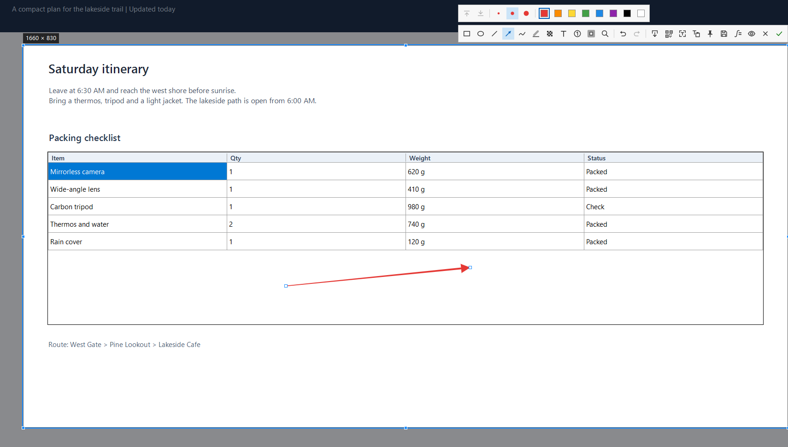
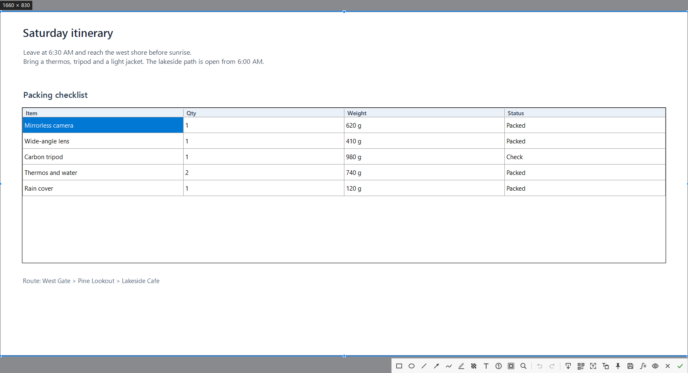
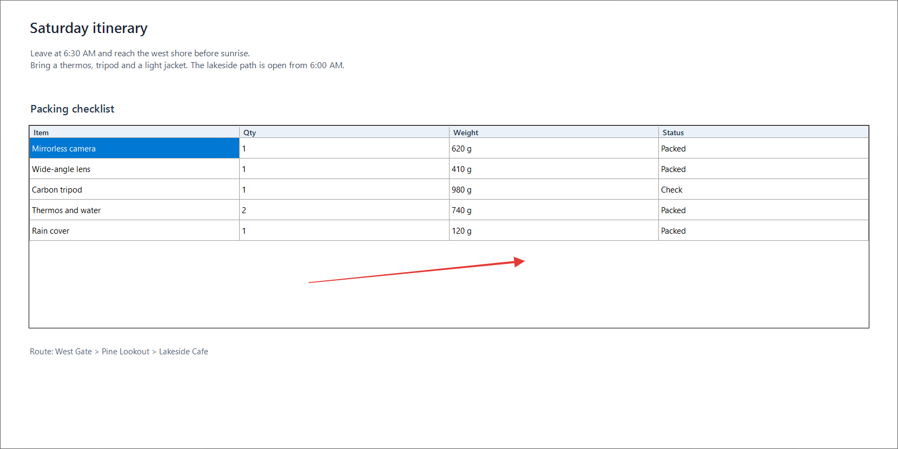
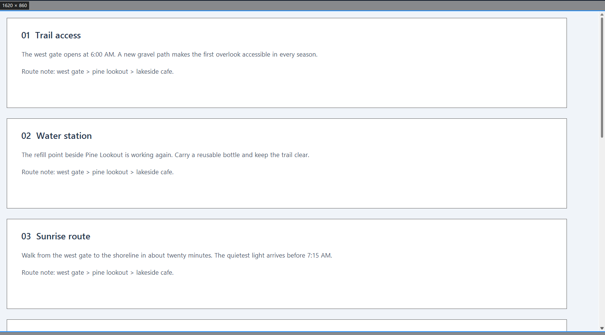
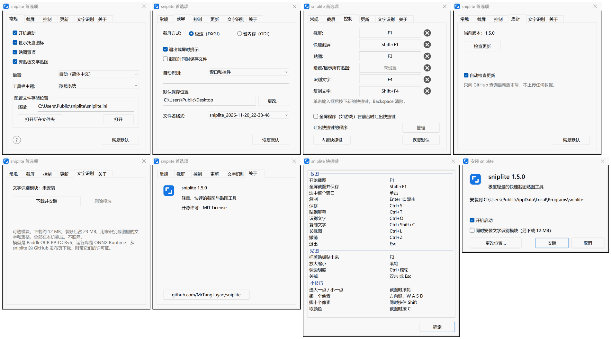

# sniplite

**轻量、快速的截图与贴图工具，核心功能使用汇编编写**

  

[**下载**](#下载) · [默认快捷键](#默认快捷键) · [常见问题](#常见问题)

 
 
 

 

## 特色

- **快速截图**：按 F1 截图，支持窗口与控件识别、放大镜和像素级选区调整。
- **轻量便携**：主程序约 291 KiB，无需安装运行库；截图与绘图核心使用汇编编写。
- **贴图与标注**：截图可置顶显示，支持箭头、文字、序号、马赛克等标注。
- **二维码识别**：按 Ctrl+Q 识别截图选区中的二维码，识别在本机完成，可复制识别结果。
- **文字识别**：可选 OCR 模块，支持普通文字和表格识别，全部在本机运行。
- **长截图**：滚动页面时自动拼接内容。
- **简洁可靠**：无广告，不上传截图或识别内容；支持 8 种界面语言。

## 下载

前往 [jinmeng3/sniplite 发布页](https://github.com/jinmeng3/sniplite/releases)获取安装包和便携版。便携版提供二维码版及附带 OCR 模块的版本；发布页当前若没有可下载文件，表示新版本尚未发布。

二维码便携包包含 `sniplite.exe`、同目录的 `sniplite_qr.exe` 和 ZXing 许可证文件。常用包名为：

- `sniplite_<版本>_portable_QR_x64.zip`
- `sniplite_<版本>_portable_QR_OCR_x64.zip`

## 默认快捷键

| 按键 | 作用 |
| --- | --- |
| **F1** | 截图 |
| **Shift+F1** | 快速截图：将鼠标所在屏幕直接保存为文件（保存位置在首选项中设置） |
| **F3** | 将剪贴板中的图片或文字贴到屏幕上 |
| **Shift+F3** | 隐藏 / 显示所有贴图 |
| **F4** | 截图并识别文字（需要 OCR 模块） |
| **Shift+F4** | 截图并直接复制识别出的文字 |
| **Enter** | 复制截图 |
| **Ctrl+S** | 保存截图 |
| **Ctrl+T** | 将截图贴到屏幕上 |
| **鼠标中键** | 将截图贴到屏幕上 |
| **Ctrl+O** | 识别截图选区中的文字 |
| **Ctrl+Shift+C** | 直接复制选区中的文字 |
| **Ctrl+Q** | 识别截图选区中的二维码 |
| **Ctrl+L** | 长截图，滚动页面时自动拼接 |
| **Esc** | 取消截图 |
| **方向键、W A S D** | 移动鼠标或选区；按住 Shift 时每次移动 10 像素 |
| **滚轮** | 截图时切换窗口范围；贴图时缩放 |
| **双击** | 关闭贴图 |

## 常见问题

**二维码识别如何工作？**

截图框选包含二维码的区域后，点击工具栏二维码按钮或按 Ctrl+Q。程序通过同目录下的 `sniplite_qr.exe` 在本机识别，结果显示在消息框中，可按 Ctrl+C 复制；程序不会自动打开识别出的网址。便携版需要将二维码 helper 与主程序放在同一目录。当前支持截图选区识别，贴图菜单和剪贴板图片尚未接入。

**软件有多大？**

主程序约 291 KiB，不到 1 MB。二维码解码器单独放在 `sniplite_qr.exe` 中，因此主程序不需要加载 ZXing。

**和 PixPin 的实测对比**

| 指标 | sniplite 1.4.0 | PixPin 3.6.6.0 |
| --- | --- | --- |
| 程序体积 | 主程序 291 KiB；二维码便携 ZIP 0.96 MiB | `PixPin.exe` 6.53 MiB；安装目录 190.99 MiB |
| 空闲工作集 | 35.48 MiB | 124.43 MiB |
| F1 到截图界面就绪（20 次） | 中位数 16.35 ms；P95 30.99 ms | 中位数 31.02 ms；P95 78.69 ms；最大值 695.16 ms |

数据来自 2026 年 11 月 18 日的同一台电脑。空闲工作集是在完成 20 次截图热键后等待 5 秒，再以 250 ms 间隔采样 20 次；界面就绪时间各测 20 次，PixPin 为 20/20 次成功。sniplite 以截图选区界面可见作为就绪，PixPin 以 PixPin 窗口成为前台作为就绪。体积一项分别列主程序、便携包与 PixPin 安装目录，统计范围不同，仅供参考；软件版本、系统状态、显示驱动和采样方式都会影响结果。

**为什么截图快？**

截图、画面合成、绘制和截图界面等对速度敏感的部分使用 x86-64 汇编编写，其余部分使用 C，且不链接 C 运行库。截图直接从显卡读取画面，再由 Windows 在显卡上合成显示。

**如何提取截图中的文字？**

框选区域后点击识别文字按钮（Ctrl+O），文字会显示在选区旁的面板中，可以选择、编辑和复制。表格保留列结构，粘贴到电子表格时会按单元格排列，也可以切换为 Markdown。Ctrl+Shift+C 可直接复制识别结果。此功能需要 OCR 模块（约 12 MB，使用 PaddleOCR PP-OCRv6 模型和 ONNX Runtime），可在首选项中安装、在安装程序中勾选，或使用带 OCR 的便携版。识别在本机完成。

**如何截取长图？**

框选区域，点击长截图按钮（Ctrl+L），然后滚动页面。sniplite 会自动拼接滚过的内容，旁边的预览条会显示当前结果。按 Enter 复制、按 Esc 取消，也可以保存、贴图或识别其中的文字。

**如何降低内存占用？**

内存占用会受显卡驱动和当前操作影响。首选项的截屏页面提供“省内存”模式，约占 2 MB，但截图速度会降低。

**软件会在电脑上留下什么？**

无需管理员权限，不修改注册表。更改设置后会创建一个设置文件；删除该文件即可恢复默认设置。

**如何更改语言？**

默认跟随 Windows 语言。也可以从托盘图标打开首选项，在“语言”中选择其他语言。

**如何更新？**

软件每天检查一次 [jinmeng3/sniplite](https://github.com/jinmeng3/sniplite) 是否有新版本。有更新时，右下角会显示通知。检查只读取版本信息，不上传数据；可以在首选项中关闭自动检查。

**如何卸载？**

在开始菜单的 sniplite 文件夹中点击“卸载 sniplite”。

**支持命令行吗？**

支持。运行 `sniplite help` 查看命令行用法。

## 首选项

## 自行编译

项目根目录中的 `w64devkit` 可直接用于构建；运行 `build.bat` 后，程序会生成在 `build` 文件夹中。也可以使用已安装的 MinGW-w64、CMake 和 Ninja。源码位于 `src`：对速度要求高的部分使用汇编文件（`.S`），其余使用 C 文件（`.c`）。程序不链接 C 运行库，仅使用 Windows 系统库。

二维码识别使用 [ZXing-C++ v3.1.1](https://github.com/zxing-cpp/zxing-cpp)，仅启用 QR Code 解码功能，遵循 Apache License 2.0；许可证随程序包提供。更多实现说明见[二维码识别文档](docs/qr-code-recognition.md)。

## 许可证

本项目采用 [MIT 许可证](LICENSE)。第三方组件各自遵循其附带许可证。

- [ZXing-C++](https://github.com/zxing-cpp/zxing-cpp) v3.1.1：Apache License 2.0，许可证随二维码程序包提供。
- [ONNX Runtime](https://github.com/microsoft/onnxruntime) 1.26.0：MIT 许可证。
- [PaddleOCR](https://github.com/PaddlePaddle/PaddleOCR) PP-OCRv6 模型：Apache License 2.0。
- 模型的 ONNX 格式来自 [RapidOCR](https://github.com/RapidAI/RapidOCR)：Apache License 2.0。
- OCR 组件的完整许可证见[上游 OCR 发布说明](https://github.com/MrTangLuyao/sniplite/releases/tag/ocr-1)。
