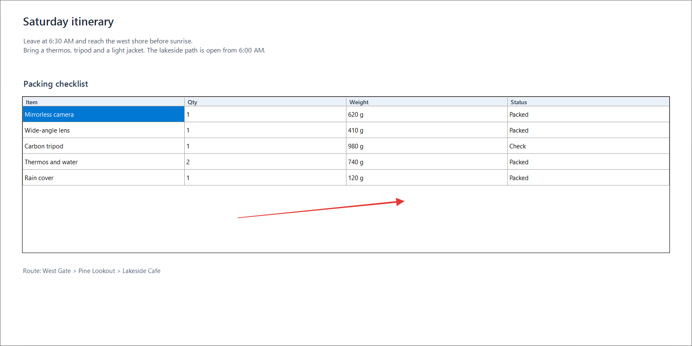
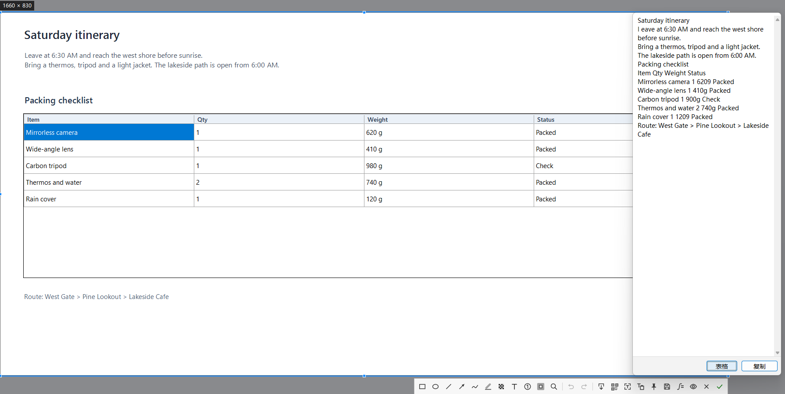
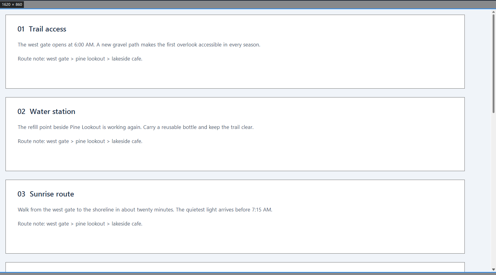
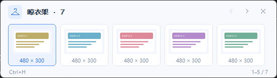

# sniplite

**A lightweight, fast screenshot and pinning tool for Windows**

[简体中文](../README.md) · [GitHub Releases](https://github.com/jinmeng3/sniplite/releases)

  

 
 
 

 

## Features

- **Screenshots:** Detect windows and controls, with a magnifier and pixel-level selection adjustment.
- **Annotations and pins:** Draw arrows, text, numbers, and mosaics; keep screenshots above other windows.
- **QR recognition:** Press `Ctrl+Q` inside a screenshot selection. Results stay on your PC and can be copied.
- **Formula recognition:** An optional CrispEmbed module converts screenshot selections to LaTeX locally with the Texo-Distill GGUF. CrispEmbed requests Vulkan, but this PP-FormulaNet model path currently runs on CPU.
- **Text recognition:** An optional OCR module recognizes text and tables locally.
- **Scrolling screenshots:** Scroll a page and automatically stitch the captured content.
- **Lightweight:** Performance-sensitive capture, composition, and drawing code uses x86-64 assembly. The main program does not link the C runtime.
- **Privacy:** Screenshots and recognition are processed locally. The app contains no ads.

## Download

Get the current version from [GitHub Releases](https://github.com/jinmeng3/sniplite/releases). Version 1.5.1.4 provides these packages:

- [Windows installer](https://github.com/jinmeng3/sniplite/releases/download/v1.5.1.4/sniplite_win_setup_amd64.exe)
- [QR portable package](https://github.com/jinmeng3/sniplite/releases/download/v1.5.1.4/sniplite_1.5.1.4_portable_QR_x64.zip): the app, QR helper, and its license.
- [QR + OCR portable package](https://github.com/jinmeng3/sniplite/releases/download/v1.5.1.4/sniplite_1.5.1.4_portable_QR_OCR_x64.zip)
- [QR + OCR + FormulaNet portable package](https://github.com/jinmeng3/sniplite/releases/download/v1.5.1.4/sniplite_1.5.1.4_portable_QR_OCR_FormulaNet_x64.zip)
- [Portable package without a preinstalled WebView2 Runtime](https://github.com/jinmeng3/sniplite/releases/download/v1.5.1.4/sniplite_1.5.1.4_portable_QR_OCR_FormulaNet_WebView2_x64.zip): includes Fixed Version Runtime 158.0.4370.33.

Extract the ZIP and run `sniplite.exe`. The `sniplite-cli.com` companion provides command-line features; it is included in the QR ZIPs and is a separate download for single-file portable builds. Keep it beside the app. Portable builds can download or remove OCR from the OCR tab in Preferences. After checking for updates in the Update tab, portable builds can download and replace existing program files locally; optional OCR, FormulaNet, and WebView2 Runtime folders are preserved. The QR helper can also be installed or removed from the QR tab. Portable builds can enable “Start with Windows” in Preferences. The shortcut points to the current program location, so do not move or rename its directory afterward. If you move it, turn the option off and on again to update the shortcut.

If the app is running as administrator, run the CLI as administrator too; a standard-integrity CLI cannot send commands to the elevated app.

The CrispEmbed formula module can be installed from the local model and runtime files or removed from the Formula tab in Preferences.

## System requirements

- Windows 10 or Windows 11, x64
- No additional runtime is required for screenshots and annotations.
- OCR requires the included or separately installed OCR module.
- Formula recognition requires the Texo-Distill GGUF model, CrispEmbed runtime, and the Microsoft Visual C++ x64 runtime.

## Default shortcuts

| Key | Action |
| --- | --- |
| **F1** | Take a screenshot |
| **Shift+F1** | Quick capture: save the screen under the pointer to a file |
| **F3** | Pin an image or text from the clipboard |
| **Shift+F3** | Hide or show all pins |
| **F4** | Capture and recognize text (OCR module required) |
| **Shift+F4** | Capture and copy recognized text |
| **Enter** | Copy the screenshot |
| **Ctrl+S** | Save the screenshot |
| **Ctrl+T** or **middle click** | Pin the screenshot |
| **Ctrl+O** | Recognize text in the screenshot selection |
| **Ctrl+Shift+C** | Copy recognized text from the selection |
| **Ctrl+Q** | Recognize QR codes in the screenshot selection |
| **Ctrl+L** | Scrolling screenshot |
| **Esc** | Cancel capture |
| **Arrow keys, W A S D** | Move the pointer or selection; hold Shift to move 10 pixels at a time |
| **Mouse wheel** | Change the window target while capturing; zoom a pin |
| **Double-click a pin** | Close it |
| **Ctrl+H (in a pin window)** | Store the current pin on the rack |

## FAQ

### How do I scan a QR code?

Capture and select the area containing the code, then click the QR toolbar button or press `Ctrl+Q`. The app uses `sniplite_qr.exe` from the same directory to decode it locally. Results appear in a message box and can be copied with `Ctrl+C`. The app does not open recognized URLs automatically. Only screenshot selections are supported; pins and clipboard images are not connected yet. See the [QR recognition guide](qr-code-recognition.en.md) or its [Simplified Chinese version](qr-code-recognition.md).
The QR tab in Preferences can install or remove the helper. After installation, use the QR button or `Ctrl+Q` in the capture editor; after removal, both are unavailable.

### How do I extract text from a screenshot?

Select an area and click the text recognition button or press `Ctrl+O`. Results appear in a panel beside the selection and can be edited and copied. Tables can preserve their columns or be converted to Markdown. This requires the OCR module, which uses PaddleOCR PP-OCRv6 and ONNX Runtime and processes images locally.
### How do I recognize a formula in a screenshot?

Select the formula in the capture editor and click the “∫” button to recognize and copy LaTeX directly. The capture editor closes after the copy succeeds. The adjacent eye button opens an offline KaTeX preview/editor in sniplite’s WebView2 window. Edited formulas can be copied with the button or `Ctrl+Enter`; syntax errors are flagged in the preview. If the current capture or selection has no matching recognition result, the eye button recognizes it before opening; it does not open an empty page when no formula is found. The preview opens on the monitor containing the selection. Extra spaces around braces and operators are removed while word separators are preserved. The formula module is about 82 MB installed and uses the local Texo-Distill GGUF with CrispEmbed. Vulkan is requested, but this PP-FormulaNet model path currently runs on CPU.
No progress dialog appears during recognition. Failures and incomplete output leave the clipboard unchanged. Solid-color blank selections are rejected.

### How do I take a scrolling screenshot?

Select an area, click the scrolling screenshot button or press `Ctrl+L`, then scroll the page. The app stitches the content as you scroll. You can copy, save, pin, or recognize text in the result.

### How do I organize multiple pins?

Dragging a pin reveals the rack. In Preferences > Pin rack, set it to the top or bottom center of the screen. Drop the pin onto the rack to collect it as a thumbnail. You can also press `Ctrl+H` in a pin window or choose “Store on rack” from its context menu. The “Pin rack” menu item opens the bar on its own.

Click a thumbnail to restore its pin. Drag a card onto another card to reorder; right-click a card to restore or close that pin. Click the empty rack area to focus it, then use the arrow keys to select, `Home`/`End` to jump, `Enter` to restore, or `Delete` to close. Drag the rack title to move it; use the wheel or `<` and `>` buttons to browse more thumbnails. Closing the rack restores every collected pin. `Shift+F3` hides or shows the rack together with uncollected pins. Collection lasts for the current session; exiting the app releases all images.

The rack uses rounded cards with hover highlights. Each card shows the original image dimensions, and the footer shows the visible range.

### How can I reduce memory use?

The capture page in Preferences has a “Low memory” mode. It reduces memory use at the cost of slower capture.

When zooming a pin, the percentage label uses a temporary drawing buffer sized to the text area instead of the entire scaled image. The default capture mode initializes graphics libraries and devices in the background; GDI capture remains available during initialization.

Scrolling screenshots commit memory for the canvas, row hashes, and thumbnail as content is stitched, instead of allocating the full maximum length in advance. These buffers are released when the scrolling capture ends.

### How do I change the language or uninstall?

The app follows the Windows language by default. Open Preferences from the system tray to choose another language. To remove an installed copy, use the uninstall shortcut in the sniplite Start menu folder.

## Comparison with PixPin

| Metric | sniplite 1.4.0 | PixPin 3.6.6.0 |
| --- | --- | --- |
| Program size | Main program 291 KiB; QR portable ZIP 0.96 MiB | `PixPin.exe` 6.53 MiB; installation directory 190.99 MiB |
| Idle working set | 35.48 MiB | 124.43 MiB |
| F1 to capture UI ready (20 runs) | Median 16.35 ms; P95 30.99 ms | Median 31.02 ms; P95 78.69 ms; max 695.16 ms |

Measurements were taken on the same PC on November 18, 2026; sniplite measurements are from version 1.4.0. Idle working set was sampled 20 times at 250 ms intervals, five seconds after 20 hotkey activations. UI readiness was measured 20 times; PixPin succeeded 20/20 times. Package sizes cover different items and are provided for reference only. Results vary with software versions, system state, display drivers, and measurement methods.

## Build from source

The project-local `w64devkit` can build the project directly. Alternatively, install MinGW-w64, CMake, and Ninja. Run `build.bat`, install the local module from the Formula tab in `build\sniplite.exe` Preferences, then run `pack.bat` to create the installer and QR portable ZIPs. The module sources are `E:\浏览器下载\texo-distill-q8_0.gguf`, `E:\浏览器下载\crispembed-windows-x86_64-vulkan`, and the installed Microsoft Visual C++ x64 runtime. Output is placed in `build\dist`.
For PCs without WebView2, download the x64 Fixed Version Runtime from [Microsoft's WebView2 page](https://developer.microsoft.com/en-us/microsoft-edge/webview2/), run `if not exist build\webview2-runtime mkdir build\webview2-runtime`, then extract it with `expand.exe <runtime.cab> -F:* build\webview2-runtime`. Running `pack.bat` then creates `..._portable_QR_OCR_CrispEmbed_WebView2_x64.zip`. The fixed runtime adds over 250 MB and does not update automatically; replace it periodically. Extract the package to a local disk and launch it with the included `start-sniplite.bat`, which applies the required Windows 10 permissions. Fixed Version does not run from a network path.

QR recognition uses [ZXing-C++ v3.1.1](https://github.com/zxing-cpp/zxing-cpp), with only QR Code decoding enabled, under Apache License 2.0. See the [QR recognition guide](qr-code-recognition.en.md) for implementation details and limitations.

## License

This project is licensed under the [GNU Affero General Public License v3.0 (AGPL-3.0)](../LICENSE-AGPL-3.0). Formula recognition uses CrispEmbed and the Texo-Distill GGUF model; their license notices are included in the formula module. ONNX Runtime remains in use for the separate text OCR module. Other third-party components are distributed under their own licenses. See `third_party/webview2` and `LICENSE-WebView2.txt` / `NOTICE-WebView2.txt` in release packages for WebView2 SDK terms and notices. See the [upstream OCR release notes](https://github.com/MrTangLuyao/sniplite/releases/tag/ocr-1) for OCR licensing details.
