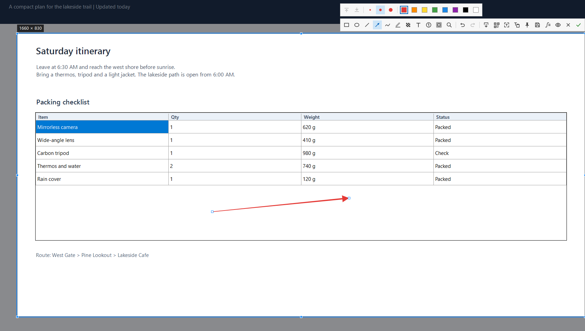
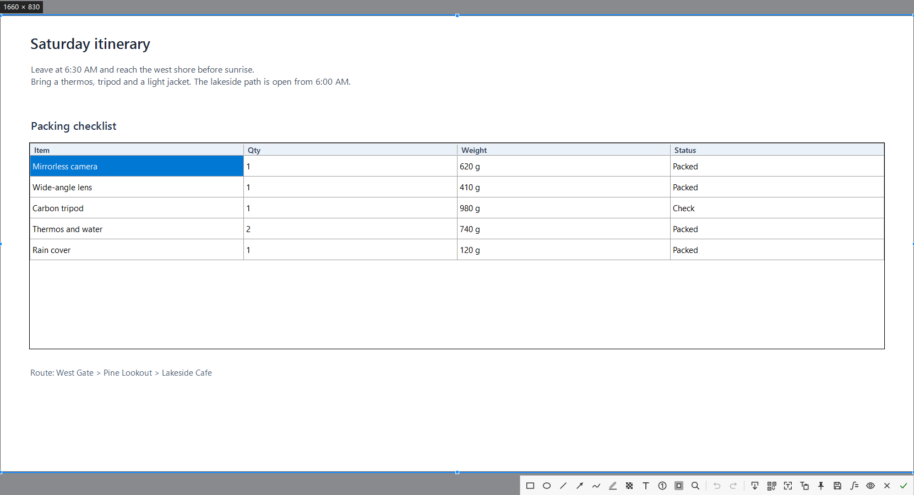
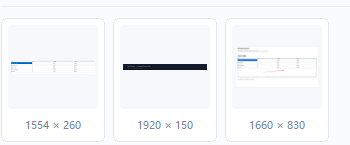

# sniplite

**A lightweight, fast screenshot and pinning tool for Windows**

[简体中文](../README.md) · [GitHub Releases](https://github.com/jinmeng3/sniplite/releases)

  

 
 
 

 

## Features

- **Screenshots:** Detect windows and controls, with a magnifier and pixel-level selection adjustment.
- **Annotations and pins:** Draw arrows, text, numbers, and mosaics; keep screenshots above other windows.
- **QR recognition:** Press `Ctrl+Q` inside a screenshot selection. Results stay on your PC and can be copied.
- **Formula recognition:** An optional CrispEmbed module converts screenshot selections to LaTeX locally with the Texo-Distill GGUF. Preferences let you choose Auto, Vulkan, AVX2, or CPU; accelerated backends fall back to CPU.
- **Text recognition:** An optional OCR module recognizes text and tables locally.
- **Scrolling screenshots:** Scroll a page and automatically stitch the captured content.
- **Lightweight:** Performance-sensitive capture, composition, and drawing code uses x86-64 assembly. The main program does not link the C runtime.
- **Privacy:** Screenshots and recognition are processed locally. The app contains no ads.

## Portable package performance

Measured on one Windows PC. OCR and FormulaNet cases had one warm-up and five independent process runs; all wall-time values are medians.

| Portable package | QR (ms; WS/commit MiB) | OCR one line (ms; WS/commit MiB) | FormulaNet (ms; WS/commit MiB) |
| --- | ---: | ---: | ---: |
| QR only | 34.5; 9.8/2.1 | — | — |
| QR + OCR CPU | 30.8; 9.8/2.1 | 315.5; 156.1/305.3 | — |
| QR + OCR AVX2 | 30.7; 9.8/2.1 | 237.2; 156.2/305.3 | — |
| QR + OCR Vulkan | 30.5; 9.8/2.1 | 295.9; 84.7/390.2 | — |
| QR + OCR + FormulaNet CPU | 31.7; 9.8/2.1 | 363.8; 156.1/305.3 | 1,428.5; 128.8/288.9 |
| QR + OCR + FormulaNet AVX2 | 32.0; 9.8/2.1 | 249.4; 156.2/305.3 | 477.5; 128.9/288.9 |
| QR + OCR + FormulaNet Vulkan | 31.3; 9.8/2.1 | 343.2; 84.7/390.2 | 386.9; 96.7/351.3 |

QR used the same test code; OCR used a 1000×260 RGB image with one text line; FormulaNet used `x² + y² = 1` at 400×100. Wall time includes process startup, model initialization, preprocessing, and inference. Memory is peak working set/peak commit sampled through Windows PSAPI every 2 ms; dedicated VRAM is excluded, and OCR memory includes both detector and recognizer models. Results vary with the GPU, driver, and system state.

## Download

Get the current version from [GitHub Releases](https://github.com/jinmeng3/sniplite/releases). Version 1.5.1.5 provides an installer and seven portable ZIPs:

- [Windows installer](https://github.com/jinmeng3/sniplite/releases/download/v1.5.1.5/sniplite_win_setup_amd64.exe)
- [QR portable package](https://github.com/jinmeng3/sniplite/releases/download/v1.5.1.5/sniplite_1.5.1.5_portable_QR_x64.zip)
- [QR + OCR CPU](https://github.com/jinmeng3/sniplite/releases/download/v1.5.1.5/sniplite_1.5.1.5_portable_QR_OCR_CPU_x64.zip)
- [QR + OCR AVX2](https://github.com/jinmeng3/sniplite/releases/download/v1.5.1.5/sniplite_1.5.1.5_portable_QR_OCR_AVX2_x64.zip)
- [QR + OCR Vulkan](https://github.com/jinmeng3/sniplite/releases/download/v1.5.1.5/sniplite_1.5.1.5_portable_QR_OCR_Vulkan_x64.zip)
- [QR + OCR + FormulaNet CPU](https://github.com/jinmeng3/sniplite/releases/download/v1.5.1.5/sniplite_1.5.1.5_portable_QR_OCR_FormulaNet_CPU_x64.zip)
- [QR + OCR + FormulaNet AVX2](https://github.com/jinmeng3/sniplite/releases/download/v1.5.1.5/sniplite_1.5.1.5_portable_QR_OCR_FormulaNet_AVX2_x64.zip)
- [QR + OCR + FormulaNet Vulkan](https://github.com/jinmeng3/sniplite/releases/download/v1.5.1.5/sniplite_1.5.1.5_portable_QR_OCR_FormulaNet_Vulkan_x64.zip)

Extract the ZIP and run `sniplite.exe`. The `sniplite-cli.com` companion provides command-line features; it is included in the QR ZIPs and is a separate download for single-file portable builds. Keep it beside the app. Portable builds can download or remove OCR from the OCR tab in Preferences. After checking for updates in the Update tab, portable builds can download and replace existing program files locally; optional OCR and formula model folders are preserved. The QR helper can also be installed or removed from the QR tab. Portable builds can enable “Start with Windows” in Preferences. The shortcut points to the current program location, so do not move or rename its directory afterward. If you move it, turn the option off and on again to update the shortcut.

If the app is running as administrator, run the CLI as administrator too; a standard-integrity CLI cannot send commands to the elevated app.

The CrispEmbed formula module can be installed from the local model and runtime files or removed from the Formula tab in Preferences.

## System requirements

- Windows 10 or Windows 11, x64
- No additional runtime is required for screenshots and annotations.
- OCR requires the included or separately installed OCR module.
- Formula recognition requires the Texo-Distill GGUF model, CrispEmbed runtime, and the Microsoft Visual C++ x64 runtime.

## Default shortcuts

| Key | Action |
| --- | --- |
| **F1** | Take a screenshot |
| **Shift+F1** | Quick capture: save the screen under the pointer to a file |
| **F3** | Pin an image or text from the clipboard |
| **Shift+F3** | Hide or show all pins |
| **F4** | Capture and recognize text (OCR module required) |
| **Shift+F4** | Capture and copy recognized text |
| **Enter** | Copy the screenshot |
| **Ctrl+S** | Save the screenshot |
| **Ctrl+T** or **middle click** | Pin the screenshot |
| **Ctrl+O** | Recognize text in the screenshot selection |
| **Ctrl+Shift+C** | Copy recognized text from the selection |
| **Ctrl+Q** | Recognize QR codes in the screenshot selection |
| **Ctrl+L** | Scrolling screenshot |
| **Esc** | Cancel capture |
| **Arrow keys, W A S D** | Move the pointer or selection; hold Shift to move 10 pixels at a time |
| **Mouse wheel** | Change the window target while capturing; zoom a pin |
| **Double-click a pin** | Close it |
| **Ctrl+H (in a pin window)** | Store the current pin on the rack |

## FAQ

### How do I scan a QR code?

Capture and select the area containing the code, then click the QR toolbar button or press `Ctrl+Q`. The app uses `sniplite_qr.exe` from the same directory to decode it locally. Results appear in a message box and can be copied with `Ctrl+C`. The app does not open recognized URLs automatically. Only screenshot selections are supported; pins and clipboard images are not connected yet. See the [QR recognition guide](qr-code-recognition.en.md) or its [Simplified Chinese version](qr-code-recognition.md).
The QR tab in Preferences can install or remove the helper. After installation, use the QR button or `Ctrl+Q` in the capture editor; after removal, both are unavailable.

### How do I extract text from a screenshot?

Select an area and click the text recognition button or press `Ctrl+O`. Results appear in a panel beside the selection and can be edited and copied. Tables can preserve their columns or be converted to Markdown. The OCR module uses the user-supplied CrispEmbed PP-OCRv6 tiny FP16 GGUF detector and recognizer through a native OCR engine built from source, processing images locally. The OCR tab in Preferences offers Auto, Vulkan, AVX2, and CPU; Auto tries Vulkan, AVX2, then generic CPU, and accelerated backends fall back to CPU when unavailable or when inference fails.
### How do I recognize a formula in a screenshot?

Select the formula in the capture editor and click the “∫” button to recognize and copy LaTeX directly. The capture editor closes after the copy succeeds. The adjacent eye button opens sniplite’s native MicroTeX preview window, where LaTeX remains editable and changes render live. Edited formulas can be copied with the button or `Ctrl+Enter`; syntax errors are flagged in the preview. If the current capture or selection has no matching recognition result, the eye button recognizes it before opening; it does not open an empty page when no formula is found. The preview opens on the monitor containing the selection. Extra spaces around braces and operators are removed while word separators are preserved. The formula module is about 82 MB installed and uses the local Texo-Distill GGUF with CrispEmbed; Preferences offer Auto, Vulkan, AVX2, or CPU, with CPU fallback when an accelerated backend fails.
No progress dialog appears during recognition. Failures and incomplete output leave the clipboard unchanged. Solid-color blank selections are rejected.

### How do I take a scrolling screenshot?

Select an area, click the scrolling screenshot button or press `Ctrl+L`, then scroll the page. The app stitches the content as you scroll. You can copy, save, pin, or recognize text in the result.

### How do I organize multiple pins?

In Preferences > Pin rack, choose the top or bottom edge. When the rack has stored pins, hold the pointer at that screen edge for about 300 ms to slide it out; it tucks away about 500 ms after the pointer leaves the cards. Drag a pin onto the revealed line to store it. You can also press `Ctrl+H` in a pin window or choose “Store on rack” from its context menu. The “Pin rack” menu item opens the rack on its own.

Click a thumbnail to restore its pin. Drag a card onto another card to reorder; right-click a card to restore or close that pin. Click a card to focus the rack, then use the arrow keys, `Home`/`End`, `Enter` to restore, or `Delete` to close. Use the wheel or `<` and `>` buttons to browse more thumbnails. Closing the rack restores every collected pin. `Shift+F3` hides or shows the rack together with uncollected pins. Collection lasts for the current session; exiting the app releases all images.

The rack uses a transparent, curved clothesline with cards held by small clips. Each card shows the original image dimensions; the footer shows the visible range.

### How can I reduce memory use?

The capture page in Preferences has a “Low memory” mode. It reduces memory use at the cost of slower capture.

When zooming a pin, the percentage label uses a temporary drawing buffer sized to the text area instead of the entire scaled image. The default capture mode initializes graphics libraries and devices in the background; GDI capture remains available during initialization.

Scrolling screenshots commit memory for the canvas, row hashes, and thumbnail as content is stitched, instead of allocating the full maximum length in advance. These buffers are released when the scrolling capture ends.

### How do I change the language or uninstall?

The app follows the Windows language by default. Open Preferences from the system tray to choose another language. To remove an installed copy, use the uninstall shortcut in the sniplite Start menu folder.

## Comparison with PixPin

| Metric | sniplite 1.4.0 | PixPin 3.6.6.0 |
| --- | --- | --- |
| Program size | Main program 291 KiB; QR portable ZIP 0.96 MiB | `PixPin.exe` 6.53 MiB; installation directory 190.99 MiB |
| Idle working set | 35.48 MiB | 124.43 MiB |
| F1 to capture UI ready (20 runs) | Median 16.35 ms; P95 30.99 ms | Median 31.02 ms; P95 78.69 ms; max 695.16 ms |

Measurements were taken on the same PC on November 18, 2026; sniplite measurements are from version 1.4.0. Idle working set was sampled 20 times at 250 ms intervals, five seconds after 20 hotkey activations. UI readiness was measured 20 times; PixPin succeeded 20/20 times. Package sizes cover different items and are provided for reference only. Results vary with software versions, system state, display drivers, and measurement methods.

## Build from source

The project-local `w64devkit` can build the project directly. Alternatively, install MinGW-w64, CMake, and Ninja. Run `build.bat`, install the formula module from the Formula tab in `build\sniplite.exe` Preferences, then run `package-all.bat`. Packaging invokes `build-cpu-runtime.bat` to build a baseline x64 CPU GGML runtime from pinned CrispEmbed `v0.17.19` sources with Vulkan disabled. `package-qr-ocr-formula.bat` creates the all-CPU inference package; `package-qr-ocr-formula-vulkan.bat` overlays the Vulkan runtime and engines. Sources are under `E:\浏览器下载`; output goes to `build\dist`.
OCR packaging also needs `PP-OCRv6_tiny_det-f16.gguf`, `PP-OCRv6_tiny_rec-f16.gguf`, and `crispembed-windows-x86_64-vulkan` in `E:\浏览器下载`. Their pinned model checksums are in `res/ocr-notice.txt`; remove any ` (1)` download suffix from the detector filename. `build.bat` compiles `build/sniplite_ocr.dll` from native PP-OCRv6 sources, with official `(2, 1)` height/width downsampling in tiny recognizer stages 3 and 4. `package-all.bat` includes the engine and complete `third_party/ppocrv6/LICENSE` in the OCR module and CPU package; the Vulkan package uses the original Vulkan GGML runtime. After changing the engine, models, or OCR notices, repack and update `MODULE_BYTES` in `src/ocr_get.c` to the actual `build/sniplite_ocr.zip` size, then rebuild and repack. Publish the ZIP under the `ocr-5` release tag.
`build.bat` builds `src/microtex` with CMake, Ninja, and g++, producing `build/sniplite_microtex.dll`, then archives `res` and `LICENSE` from `third_party/microtex` as `build/microtex-assets.zip`. The DLL, resources, and license are embedded in the main executable. The installer and all four portable ZIPs include native MicroTeX preview without an additional preview runtime. Each portable package includes `LICENSE-MicroTeX.txt` beside the executable; font licenses remain in the resources.

The native renderer also uses TinyXML2 10.0.0; see `third_party/tinyxml2/LICENSE.txt`. The installer and all portable ZIPs include `LICENSE-TinyXML2.txt` beside the executable.

QR recognition uses [ZXing-C++ v3.1.1](https://github.com/zxing-cpp/zxing-cpp), with only QR Code decoding enabled, under Apache License 2.0. See the [QR recognition guide](qr-code-recognition.en.md) for implementation details and limitations.

## License

This project is licensed under the [GNU Affero General Public License v3.0 (AGPL-3.0)](../LICENSE-AGPL-3.0). Formula recognition uses CrispEmbed and the Texo-Distill GGUF model; their license notices are included in the formula module. Text OCR uses CrispEmbed's PP-OCRv6 GGUF models and GGML runtime; the OCR module includes their MIT and Apache 2.0 licenses and third-party notices. Formula preview uses MicroTeX; see `third_party/microtex/LICENSE` and `LICENSE-MicroTeX.txt` in release packages. Font licenses remain in the embedded preview resources. Other third-party components are distributed under their own licenses.
