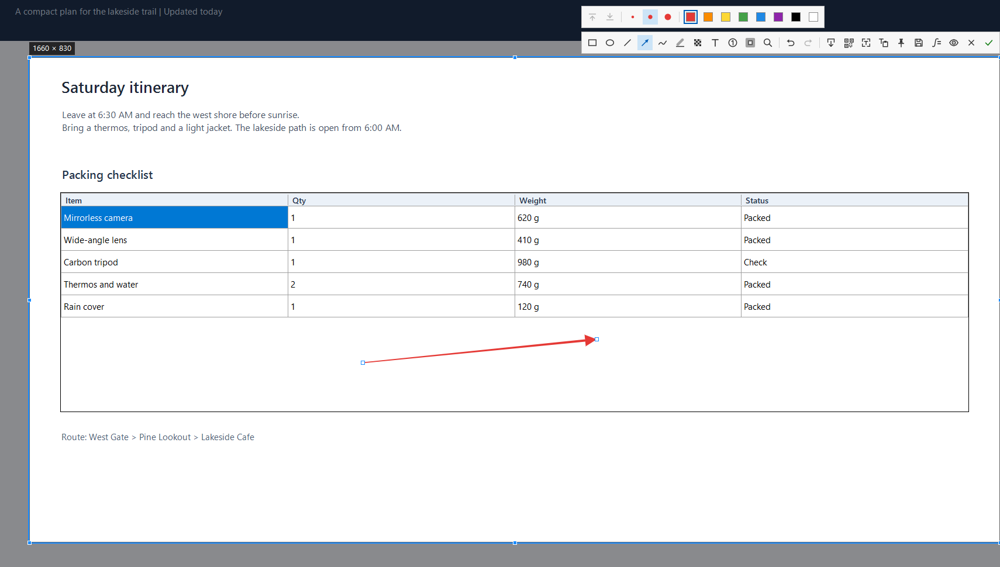
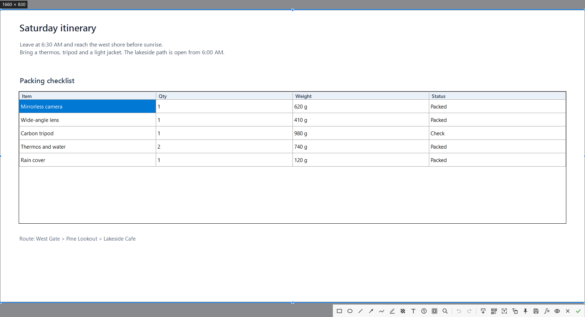
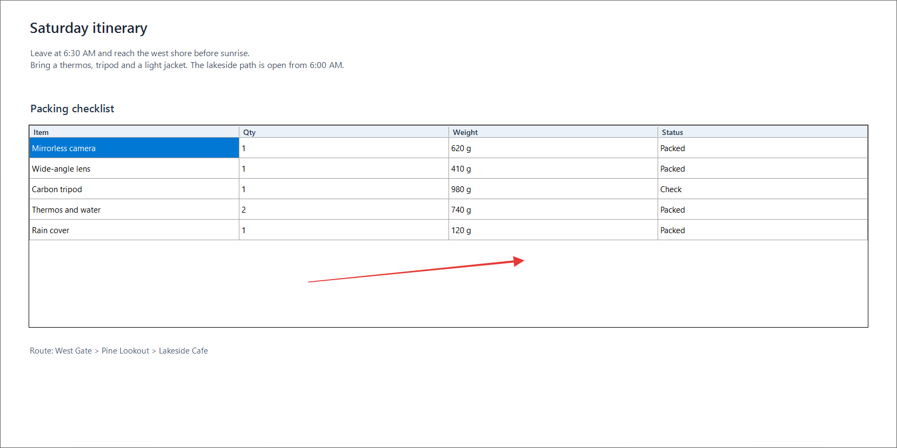
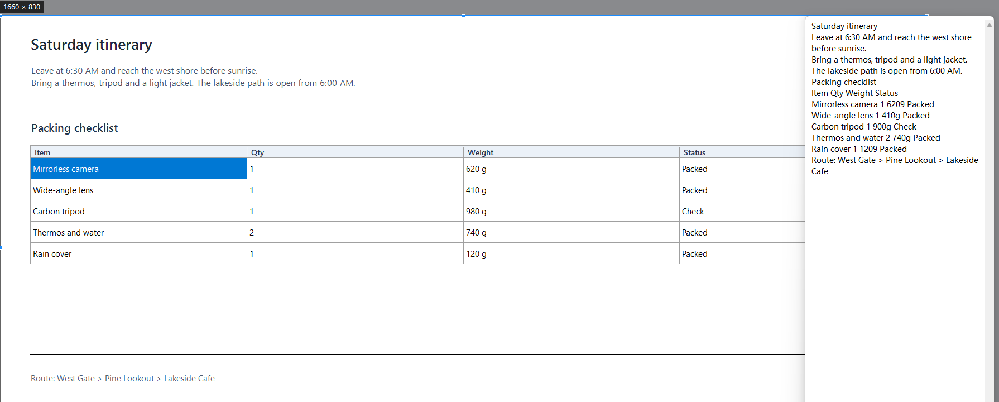
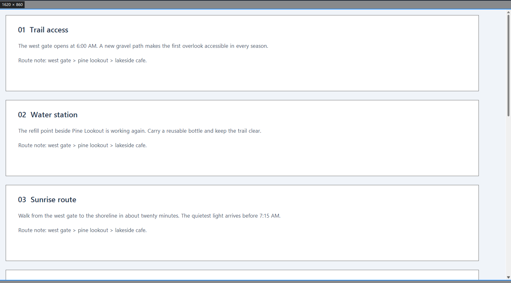
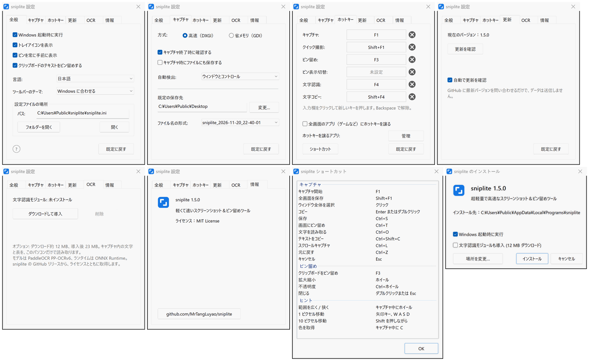

# SnapRail

**とても軽くて速い、スクリーンショットとピン留めのツール。コア部分はアセンブリ言語で書かれています**

       

  

[**ダウンロード**](#ダウンロード) | [既定のショートカット](#既定のショートカット) | [よくある質問](#よくある質問)

 
 
 

 

## 特長

- **速い**：F1 を押せばすぐキャプチャ。99% のスクリーンショットソフトより速く表示されます
- **軽い**：本体は約 320 KB。ランタイムのインストールは不要で、キャプチャと描画のコア部分はアセンブリ言語です
- **ピン留め**：スクリーンショットを最前面に固定。ほかのウィンドウに切り替えても隠れないので、見比べるのに便利です
- **十分な機能**：キャプチャ、ピン留め、矢印、文字、モザイク、スポットライト、拡大鏡がひととおり揃っています
- **文字認識**：キャプチャ内の文字や表を読み取れます。任意で追加するモジュールで、すべてこのパソコン上で動きます
- **スクロールキャプチャ**：ページをスクロールすると、その場でつなぎ合わせます
- **クリーン**：広告なし、オープンソース、ログなし、データ収集なし
- **多言語**：8 言語に対応。既定では Windows の言語に従い、自分で選ぶこともできます

## ダウンロード

[Releases](https://github.com/MrTangLuyao/sniplite/releases/latest) から最新版のインストーラーを入手してください。

インストール不要のポータブル ZIP は 7 種類です。QR のみが 1 種類、QR+OCR と QR+OCR+FormulaNet はそれぞれ CPU、AVX2、Vulkan の 3 種類です。ファイル名は `_portable_QR_OCR_<CPU|AVX2|Vulkan>_x64.zip` と `_portable_QR_OCR_FormulaNet_<CPU|AVX2|Vulkan>_x64.zip` です。Vulkan 版は Vulkan、AVX2、汎用 CPU の順に試します。すべて MicroTeX のネイティブ数式プレビューを含みます。

> [!TIP]
> アイコンはタスクバーの右端にあります。見当たらないときは、そこの小さな矢印をクリックしてください。常に表示するには、Windows の設定で **その他のシステム トレイ アイコン** を検索し、SnapRail をオンにします。

## 既定のショートカット

| キー | 動作 |
| --- | --- |
| **F1** | キャプチャ |
| **Shift+F1** | クイック撮影：マウスのある画面をそのままファイルに保存（保存先は設定で変更） |
| **F3** | コピーした画像や文字を画面にピン留め |
| **Shift+F3** | すべてのピンを隠す / 表示 |
| **F4** | キャプチャして文字を読み取る（文字認識モジュールが必要） |
| **Shift+F4** | キャプチャして文字をそのままコピー |
| **Enter** | キャプチャをコピー |
| **Ctrl+S** | キャプチャを保存 |
| **Ctrl+T** | キャプチャを画面にピン留め |
| **中クリック** | キャプチャを画面にピン留め |
| **Ctrl+O** | 選択範囲の文字を読み取る |
| **Ctrl+Shift+C** | 選択範囲の文字をそのままコピー |
| **Ctrl+L** | スクロールキャプチャ（スクロールすると自動でつなぎます） |
| **Esc** | キャプチャをキャンセル |
| **矢印キー**、**W A S D** | カーソルまたは選択範囲を 1 ピクセル移動、Shift を押しながらで 10 ピクセル |
| **ホイール** | キャプチャ中は選択するウィンドウの範囲を変更、ピンでは拡大縮小 |
| **ダブルクリック** | ピンを閉じる |

## よくある質問

**サイズはどのくらい？**

とても軽く、1 MB もありません。

**なぜこんなに速いの？**

速さが必要な部分（キャプチャ、画面の合成、描画、キャプチャ画面）は x86-64 アセンブリ言語で、それ以外は C で書かれており、C ランタイムには依存しません。画面を GPU から直接読み取り、合成も GPU 上で Windows に任せるため、Windows で一般的なキャプチャ方法よりずっと高速です。

**ほかのソフトと比べると？**

| ソフト | ダウンロード | 待機時のメモリ | ショートカットから撮れるまで |
| --- | --- | --- | --- |
| **SnapRail** | 0.4 MB | 11 MB | 12 ミリ秒 |
| Snipaste 2.11.3 | 19 MB | 50 MB | 121 ミリ秒 |
| PixPin 3.6.6 | 66 MB | 31 MB | 142 ミリ秒 |
| Greenshot 1.3.328 | 4 MB | 16 MB | 252 ミリ秒 |
| Flameshot 15.0.0 | 18 MB | 6 MB | 未計測 |
| ShareX 22.4.0 | 139 MB | 58 MB | 未計測 |

厳密なテストではなく、参考程度の数字です。

**スクリーンショットの文字を取り出すには？**

範囲を選んで文字認識ボタン（Ctrl+O）を押すと、選択範囲の横のパネルに文字が表示され、選択、編集、コピーができます。表は列を保ったまま読み取るので、表計算ソフトにセルとして貼り付けられ、Markdown 形式にも切り替えられます。Ctrl+Shift+C なら文字をすぐにコピーします。CrispEmbed の PP-OCRv6 tiny GGUF 検出モデルと tiny GGUF 認識モデルを使う OCR モジュールが必要です。単独では約 81 MB、数式認識モジュール導入済みなら追加分は約 21 MB です。文字と表はローカルで認識します。設定の OCR タブでは自動、Vulkan、AVX2、CPU を選択でき、自動は Vulkan、AVX2、汎用 CPU の順に試し、加速バックエンドが利用できない場合や推論に失敗した場合は CPU に切り替えます。設定やインストーラーから導入するか、OCR 付きのポータブル版を使ってください。導入するまで文字ボタンは表示されません。F4 と Shift+F4 は、キャプチャしてすぐに文字を読み取るかコピーします。

**長いスクリーンショットを撮るには？**

範囲を選んでスクロールキャプチャボタン（Ctrl+L）を押し、ページを自分でスクロールします。スクロールした分を SnapRail が自動でつなぎ、横の帯にそこまでの結果が表示されます。Enter でコピー、Esc でキャンセル。保存、ピン留め、文字の読み取りもできます。

**キャプチャはどこに保存される？**

Ctrl+S の保存ダイアログには、前回保存したフォルダーが表示されます（初めて保存するときやそのフォルダーがなくなっているときは、既定の保存先を変更していればそこが、変更していなければピクチャが表示されます）。クイック撮影（Shift+F1）は既定の保存先にそのまま保存します。既定の保存先は変更しない限りデスクトップで、設定の **キャプチャ** タブで変えられます。そこで **キャプチャ時にファイルにも保存する** をオンにすると、コピーやピン留めしたキャプチャも同じフォルダーに保存されます。同じタブの **ファイル名の形式** では、日付と時刻を使ったいくつかの形式から名前の付け方を選べます。

**ゲーム中にホットキーが邪魔になるときは？**

設定の **ホットキー** タブで **全画面のアプリ（ゲームなど）にホットキーを譲る** をオンにすると、画面全体を使うプログラムが前面にある間は SnapRail がホットキーを手放し、キーはそのプログラムに届きます。別のウィンドウに切り替えると元に戻ります。全画面で動かないプログラムは **ホットキーを譲るアプリ** に追加できます。**管理** をクリックし、**新規** でファイル名（例：`game.exe`）を入力するか、**参照** でプログラムを選びます。

**メモリはどのくらい使う？**

通常は約 50 MB で、ほとんどはグラフィックドライバーが使う分です。キャプチャ直後は一時的に少し増えます。もっと抑えたい場合は、設定の **キャプチャ** タブで **省メモリ** を選ぶと約 2 MB になりますが、キャプチャは少し遅くなります。

**パソコンに何か残る？**

管理者権限は不要で、レジストリも変更しません。設定を変えるか、保存ダイアログで保存すると（フォルダーを覚えるため）設定ファイルが 1 つ作られ、削除すれば既定に戻ります。

**言語を変えるには？**

既定では Windows の言語に従います。変えるには、トレイアイコンから設定を開き、**言語** で選びます。

**更新するには？**

1 日に 1 回、新しいバージョンがあるか GitHub に確認します。あれば画面右下に通知が出て、クリックするだけで更新できます。確認するのはバージョン番号だけで、データは一切送信しません。設定でオフにもできます。ポータブル版は更新を確認しないので、新しいバージョンは [Releases](https://github.com/MrTangLuyao/sniplite/releases/latest) から入手してください。

**アンインストールするには？**

スタートメニューの sniplite フォルダーにある **sniplite のアンインストール** をクリックします。プログラム、設定、ショートカットが削除されます。

**コマンドラインは使える？**

使えます。`sniplite help` で使い方を表示します。

## 設定画面

## 自分でビルドする

[w64devkit](https://github.com/skeeto/w64devkit)（またはほかの MinGW-w64）をインストールし、その `bin` フォルダーを PATH に追加して `build.bat` を実行すると、`build` フォルダーにプログラムができます。ソースは `src` にあります。速さが必要な部分はアセンブリファイル（`.S`）で、gcc が GNU アセンブラーでアセンブルし、それ以外は C ファイル（`.c`）です。C ランタイムはリンクせず、Windows 標準のシステムライブラリだけを使います。

## ライセンス

[AGPL-3.0](../LICENSE-AGPL-3.0)

## サードパーティのオープンソース

SnapRail 本体は Windows 標準のシステムライブラリだけを使います。オプションの文字認識モジュールはほかの方々の成果物で、変更を加えず、ライセンスとともに配布しています（ライセンスまたはそのリンクは、モジュールの `ocr` フォルダーと[モジュールのリリースページ](https://github.com/MrTangLuyao/sniplite/releases/tag/ocr-4)にあります）。

- [CrispEmbed](https://github.com/CrispStrobe/CrispEmbed) ランタイム（MIT ライセンス）。CrispEmbed、GGML、および各コンポーネントの表示は OCR モジュールに含まれています
- [PaddleOCR](https://github.com/PaddlePaddle/PaddleOCR) の PP-OCRv6 モデル、Copyright (c) PaddlePaddle Authors、Apache License 2.0。GGUF 版は CrispEmbed が提供します
- CrispEmbed/ggml に必要な [Microsoft Visual C++](https://learn.microsoft.com/cpp/windows/redistributing-visual-cpp-files) ランタイム 14.51.36247（`msvcp140.dll`、`msvcp140_1.dll`、`vcruntime140.dll`、`vcruntime140_1.dll`）、Copyright (c) Microsoft Corporation。オープンソースではなく、Microsoft の[ライセンス条項](https://visualstudio.microsoft.com/license-terms/)に従って再頒布します
